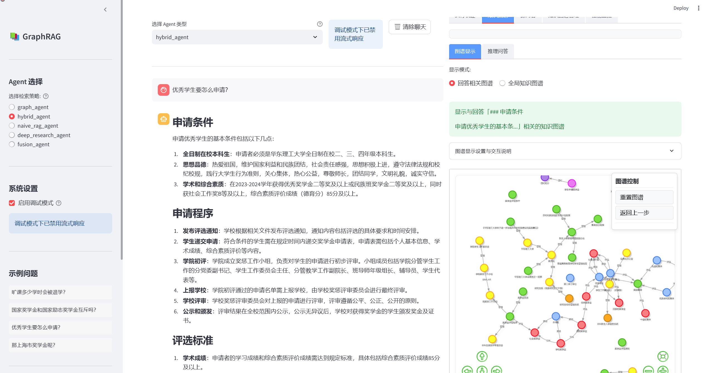

# Graph Naive RAG Demo

A research-agent prototype combining vector retrieval, keyword search and knowledge-graph exploration. It includes canonical document deduplication, reference folding, evidence checks and a Streamlit interface for inspecting answers and retrieval traces.



## Setup

Use Python 3.10. Install `requirements.txt` and copy `.env.example` to `.env`. Configure the model providers and Neo4j connection, then place your source documents in `files/` and set the knowledge-base topic in `config/settings.py`.

```sh
pip install -r requirements.txt
pip install -e .
cp .env.example .env
python build/main.py
```

Run the backend and frontend in separate terminals:

```sh
python server/main.py
```

```sh
streamlit run frontend/app.py
```

- [Setup details](assets/start.md)
- [Canonical deduplication and reference folding](canonical_README.md)
- [Knowledge-base controls](README_STRICT_KB_MODE.md)

## Reference

This prototype builds on [graph-rag-agent](https://github.com/1517005260/graph-rag-agent). The [original project documentation and acknowledgments](UPSTREAM_README.md) are retained.
